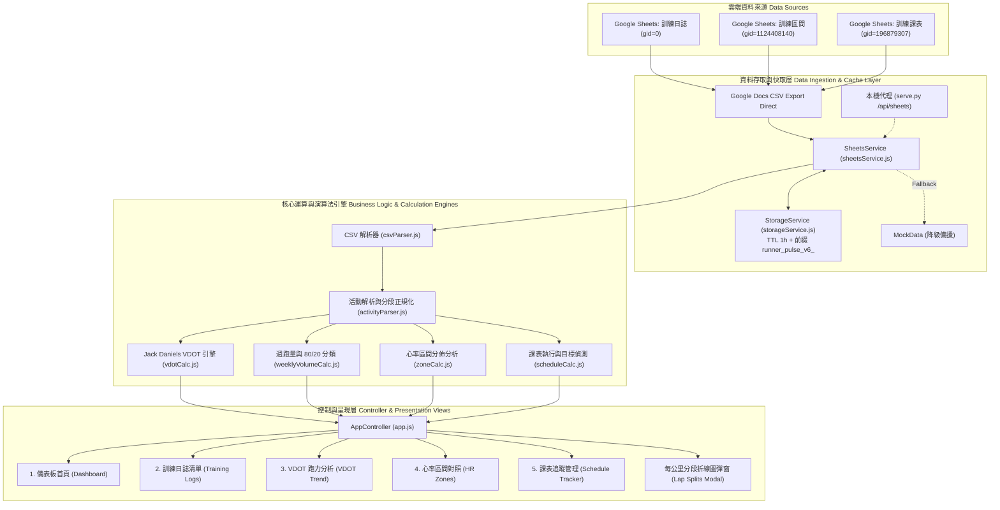
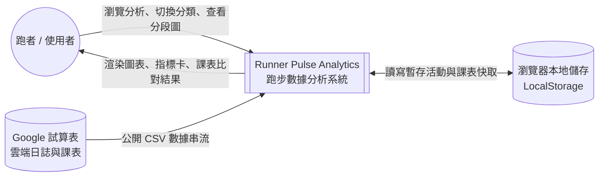
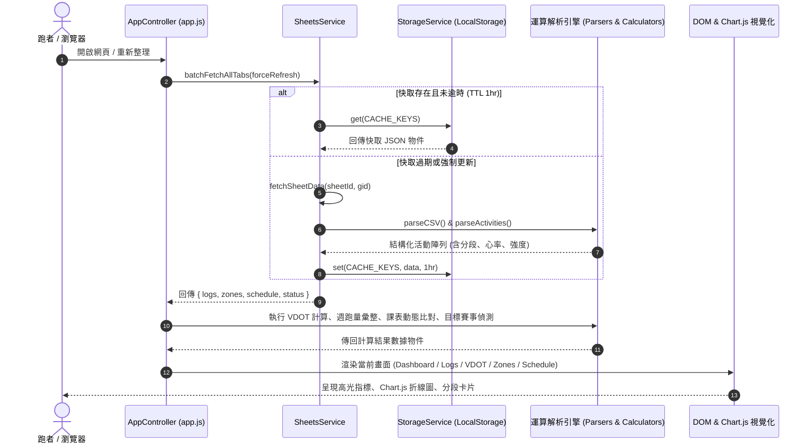

# Runner Pulse Analytics — 系統架構、功能規格與邏輯開發手冊
> **文件版本**：v2.0 (正式交付版)  
> **編寫角色**：Technical PM (`@01_role_pm.md`) + Senior SA (`@02_role_sa.md`) + Principal Architect (`@03_role_architect.md`)  
> **適用對象**：全端工程師、系統分析師、跑者用戶、維運與未來迭代團隊  
> **線上站點**：
> - GitHub Pages: [https://tobby0306.github.io/Runner_Web/](https://tobby0306.github.io/Runner_Web/)  
> - Netlify: [https://tobby-runner-web.netlify.app](https://tobby-runner-web.netlify.app)  
> **資料來源**：[Google 試算表 - 訓練日誌](https://docs.google.com/spreadsheets/d/1DahiYbLvl4zR6-5EABCSwTATCtkP7N3IywSxWo5JKas/)

---

## 1. 專案說明 (Project Overview)

### 1.1 專案背景與痛點
本系統為專為長跑選手與馬拉松跑者打造的 **個人化跑步數據解析與 VDOT 心率分析系統 (Runner Pulse Analytics)**。
跑者長期在 Google 試算表記錄大量歷史 Garmin 活動日誌（2020 台北馬 ～ 2026 年，超過 200+ 趟），欄位包含 Garmin 活動 ID、日期、名稱、配速、心率、步頻、步幅、備註以及每公里分段資料。
過去面臨的痛點包括：
1. **試算表純文字難以視覺化**：缺乏長期跑力（VDOT）爬升曲線、無法直觀分析每公里配速與心率漂移。
2. **心率強度監控不易**：難以即時評估是否遵守「80/20 有氧法則」（低強度 80% vs 質量課 20%）。
3. **課表執行成效難以對比**：計畫里程與實際 Garmin 匯入數據分開，難以掌握課表完成率。
4. **跨裝置使用困難**：在操場練跑後用手機查閱試算表體驗極差，需要支援手機窄螢幕操作的 Web App。

### 1.2 核心價值與架構定位
- **零後端伺服器負擔 (Serverless SPA)**：純原生 ES6+ JavaScript 模組化架構，不依賴龐大框架，秒級極速載入。
- **即時試算表雙向聯動**：直接以 CSV 直連或本機代理拉取 Google Sheets，試算表一更新，首頁與課表立即連動。
- **專業級 Jack Daniels 跑力體系**：內建 Daniels Running Formula 耗氧量與 %VO2max 數學模型，自動反推全馬力與各配速區間。
- **極致 RWD 手機優化**：手機抽屜導覽選單、防爆版水平滑動表格、觸控友善圖表與彈窗。

### 1.3 技術棧矩陣 (Technology Stack)
| 領域 | 技術選型 | 選擇理由 |
|---|---|---|
| **核心語言** | Vanilla ES6+ JavaScript (ES Modules) | 輕量極速、原生支援瀏覽器、無編譯依賴、程式碼維護透明 |
| **結構與排版** | Semantic HTML5 + Custom Modern CSS | CSS 自訂變數、深色跑者儀表板、玻璃擬態 (Glassmorphism)、RWD Grid |
| **圖表視覺化** | Chart.js v4.4.1 (UMD) | 高效能 Canvas 繪製、雙軸配速逆轉顯示、堆疊長條圖與圓餅圖 |
| **資料儲存/快取** | LocalStorage + MemoryCache (TTL 1h) | 離線優先、大幅減少對 Google Sheets 的 API 請求，防請求超流 |
| **雲端靜態部署** | GitHub Pages + Netlify (CI/CD) | 免費全球 CDN、自動化 Git Push 觸發持續部署、HTTPS 憑證保護 |

---

## 2. 系統架構 (System Architecture)

### 2.1 整體系統架構圖 (Mermaid Architecture)



---

### 2.2 資料流程圖 (Data Flow Diagram - DFD)

#### DFD Level 0 (Context Diagram 系統環境圖)



#### DFD Level 1 (詳細資料處理流程)



---

### 2.3 檔案目錄結構與職責清單 (File Inventory)

```
c:\Antigravity_WS\Runner_Web\
├── index.html                      # 主應用程式 SPA 入口骨架與導覽列
├── running_analyzer_spec.md        # 原始需求規格書
├── RUNNER_PULSE_SYSTEM_SPEC_AND_MANUAL.md # 本架構手冊
├── README.md                       # 專案快速啟動說明
├── serve.py                        # 本機開發 HTTP 伺服器與 Google Sheets 反向代理
├── start.bat                       # 一鍵啟動批次檔
├── .gitignore                      # Git 版本控制忽略清單
├── .rules/                         # 團隊角色定義與規範手冊
│   ├── 01_role_pm.md
│   ├── 02_role_sa.md
│   ├── 03_role_architect.md
│   ├── 04_role_uxui.md
│   ├── 05_role_frontend.md
│   ├── 06_role_backend.md
│   └── 07_role_qa.md
├── css/                            # 樣式表層 (遵循設計系統)
│   ├── index.css                   # 全域 CSS 變數、顏色、字體與重設基底
│   ├── layout.css                  # 佈局網格、側邊欄、頂部導覽列與 RWD 斷點
│   └── components.css              # 卡片、按鈕、表格、徽章、模態彈窗樣式
└── js/                             # JavaScript 模組層 (ES Modules)
    ├── app.js                      # 主控核心：路由分發、DOM 事件與 View 渲染
    ├── config.js                   # 系統全域設定 (SheetID, GID, Cache 前綴, 跑者常數)
    ├── mock/
    │   └── mockData.js             # 降級備援資料 (Mock Data)
    ├── services/
    │   ├── sheetsService.js        # Google Sheets 批次載入、解析與三層容錯服務
    │   └── storageService.js       # LocalStorage 快取封裝 (帶 TTL 與記憶體 Fallback)
    └── utils/
        ├── activityParser.js       # 日誌文字解析、每公里分段正規表示式、強度判定
        ├── csvParser.js            # RFC 4180 標準相容 CSV 解析演算法
        ├── formatters.js           # 日期、配速 (MM:SS)、時間與字串格式化工具
        ├── scheduleCalc.js         # 課表「計畫 vs 實際」比對引擎、五態評定、目標賽事偵測
        ├── vdotCalc.js             # Jack Daniels VDOT 耗氧公式與完賽時間預測
        ├── weeklyVolumeCalc.js     # 週跑量時間窗口統計與 80/20 法則分佈
        └── zoneCalc.js             # 心率五大區間百分比分佈與月度對比運算
```

---

## 3. 各功能模組詳細說明與邏輯代碼對照表

本節針對系統內 10 大核心功能，逐一拆解其**業務目標、計算公式、核心 Method、以及精確的程式碼檔案位置與行號區間**。

---

### 模組 1：Google Sheets 批次同步、三層容錯與快取降級策略 (Task T-02)

#### 1. 業務場景與目的
跑者在雲端 Google 試算表擁有 3 個核心頁籤（訓練日誌 gid=0、訓練區間 gid=1124408140、課表 gid=196879307）。系統必須支援自動平行拉取，並在網路斷線、CORS 限制或 Google 端異常時自動降級。

#### 2. 核心邏輯與降級機制
1. **策略判斷**：檢查執行環境是否為本機（`window.location.hostname === 'localhost'`）。若是，走本機代理 `/api/sheets?gid=...`；若處於生產環境（GitHub Pages / Netlify），直連 Google Sheets 公開匯出端點 `https://docs.google.com/spreadsheets/d/${sheetId}/export?format=csv&gid=${gid}`。
2. **三層平滑降級 (Graceful Degradation)**：
   - 第一層：**LIVE** 連線成功 ➔ 存入 LocalStorage（有效期 1 小時）➔ 狀態 `DataSourceStatus.LIVE`。
   - 第二層：連線失敗但本地有歷史資料 ➔ 讀取過期快取 ➔ 狀態 `DataSourceStatus.CACHED`，並跳出黃色警示。
   - 第三層：初次載入且網路完全中斷 ➔ 載入預載標準 Mock Data ➔ 狀態 `DataSourceStatus.MOCK`。

#### 3. 核心方法與程式碼對照
- **檔案路徑**：[js/services/sheetsService.js](file:///c:/Antigravity_WS/Runner_Web/js/services/sheetsService.js#L35-L210)
  - `fetchSheetData(sheetId, gid)`：行 [L35-L69](file:///c:/Antigravity_WS/Runner_Web/js/services/sheetsService.js#L35-L69)，負責判斷本機/線上環境與 HTTP 串流擷取。
  - `batchFetchAllTabs(forceRefresh)`：行 [L84-L166](file:///c:/Antigravity_WS/Runner_Web/js/services/sheetsService.js#L84-L166)，使用 `Promise.all` 平行非同步讀取 3 頁籤，並統計 raw rows。
  - 降級與快取回退邏輯：行 [L167-L208](file:///c:/Antigravity_WS/Runner_Web/js/services/sheetsService.js#L167-L208)。
- **本機 Proxy 檔案**：[serve.py](file:///c:/Antigravity_WS/Runner_Web/serve.py#L30-L75)，提供本機跨域處理。

---

### 模組 2：訓練日誌解析層與文字分段正規化 (Task T-03, T-11)

#### 1. 業務場景與目的
試算表中的訓練日誌是從 Garmin 匯出的文字資料，欄位包含日期 ISO 字串、配速 `7:05`、時間 `1:30:04`，以及格式多變的「每公里分段」字串。本模組需將非結構化文字清洗為強型別物件，並嚴格由最新向舊（倒序）排序。

#### 2. 核心邏輯與正規表達式
- **時間制與距離制混合正則解析**：
  ```javascript
  const LAP_SPLIT_REGEX = /([0-9]+(?:\.[0-9]+)?(?:min|k|km)?|[0-9]+)\s*\(\s*(\d+:\d+)\s*,\s*(?:Max\d+bpm,\s*Avg)?(\d+(?:\.\d+)?)\s*bpm\s*\)([^\|\n\"]*)/gi;
  ```
  能同時解析：
  - 標準距離：`1k(7:32, 110bpm)`
  - 時間間歇：`15min(6:43, 128bpm)-平均步頻183平均步幅0.8`
  - 休息標籤：`3min(5:34, 149bpm)-平均步頻187平均步幅0.96 *break 1min`
- **活動強度自動歸類 (`classifyWorkoutType`)**：
  依照活動名稱關鍵字（`Test` ➔ TEST、`萬金石/馬拉松` ➔ RACE、`T -/min T` ➔ THRESHOLD、`200m R` ➔ REPETITION、`E-` ➔ EASY）。
- **倒序排序演算法**：以 `getActivityTimestamp(b) - getActivityTimestamp(a)` 進行數值比對。

#### 3. 核心方法與程式碼對照
- **檔案路徑**：[js/utils/activityParser.js](file:///c:/Antigravity_WS/Runner_Web/js/utils/activityParser.js)
  - `parseActivities(rawRows)`：行 [L190-L280](file:///c:/Antigravity_WS/Runner_Web/js/utils/activityParser.js#L190-L280)，主解析器。
  - `parseLapSplits(splitsString)`：行 [L120-L188](file:///c:/Antigravity_WS/Runner_Web/js/utils/activityParser.js#L120-L188)，每公里分段正規擷取。
  - `classifyWorkoutType(activityName)`：行 [L65-L115](file:///c:/Antigravity_WS/Runner_Web/js/utils/activityParser.js#L65-L115)，7 大強度自動識別。
  - `classifyPaceZone(paceSec)`：行 [L36-L63](file:///c:/Antigravity_WS/Runner_Web/js/utils/activityParser.js#L36-L63)，依分段配速秒數判定對應落點。

---

### 模組 3：Jack Daniels VDOT 跑力計算與賽事預測引擎 (Task T-07, T-08)

#### 1. 業務場景與目的
VDOT 是世界著名跑步教練 Jack Daniels 發明的跑力指數。系統自動從跑者歷史紀錄中篩選「測驗（TEST）」與「比賽（RACE）」活動，計算跑者歷年的跑力演變，並在圖表上繪製 VDOT 歷史爬升折線，同時自動推算 5K/10K/半馬/全馬的預估完賽時間。

#### 2. 核心公式與數學模型
1. **速度換算**：$v = \frac{d\text{ (公尺)}}{t\text{ (分鐘)}}$
2. **耗氧量公式 (Daniels Oxygen Cost)**：
   $$VO_2 = -4.60 + 0.182258 \cdot v + 0.000104 \cdot v^2$$
3. **極限持續能力曲線 (%VO2max drop-off)**：
   $$\%VO_2\text{max} = 0.8 + 0.1894393 \cdot e^{-0.012778 \cdot t} + 0.2989558 \cdot e^{-0.1932605 \cdot t}$$
4. **VDOT 跑力**：
   $$\text{VDOT} = \frac{VO_2}{\%VO_2\text{max}}$$

#### 3. 核心方法與程式碼對照
- **檔案路徑**：[js/utils/vdotCalc.js](file:///c:/Antigravity_WS/Runner_Web/js/utils/vdotCalc.js)
  - `calcVDOT(distanceKm, finishTimeSec)`：行 [L15-L40](file:///c:/Antigravity_WS/Runner_Web/js/utils/vdotCalc.js#L15-L40)，實作耗氧量與極限比率公式。
  - `extractVDOTMilestones(activities)`：行 [L47-L81](file:///c:/Antigravity_WS/Runner_Web/js/utils/vdotCalc.js#L47-L81)，從日誌中萃取里程大於 3K 的測驗與賽事點。
  - `getVDOTPredictions(vdot)`：行 [L88-L126](file:///c:/Antigravity_WS/Runner_Web/js/utils/vdotCalc.js#L88-L126)，反推四項標準賽事完賽時間與 E/M/T/I/R 訓練配速。
- **視圖繪製**：[js/app.js](file:///c:/Antigravity_WS/Runner_Web/js/app.js#L950-L1070) `renderVdotAnalysisView()` 與 Chart.js 折線圖配置。

---

### 模組 4：訓練類型分類 (7 大體系) 與週跑量統計圖 (Task T-10)

#### 1. 業務場景與目的
實踐馬拉松訓練「80/20 法則」，追蹤跑者每週累積的訓練里程、訓練時長，並以彩色堆疊長條圖呈現各類別比例（輕鬆跑、馬拉松跑、門檻跑、間歇跑、速度跑、比賽、測驗）。

#### 2. 核心邏輯
- **週次對齊**：依 ISO 8601 週曆（每週一為起始日，週日為結尾），計算 `YYYY-Wxx`。
- **多週期時間篩選切換**：支援「近 8 週 (`8weeks`)」、「近 12 週 (`12weeks`)」、「2026 年度 (`2026`)」、「歷年全部 (`all`)」。
- **80/20 有氧健康度評估**：
  $$\text{有氧比例} = \frac{\text{Easy 里程}}{\text{總里程}} \times 100\%$$
  若大於 75% 評定為「🟢 優秀（有氧打底紮實）」，若低於 65% 則給予「⚠️ 質量偏高」警示。

#### 3. 核心方法與程式碼對照
- **檔案路徑**：[js/utils/weeklyVolumeCalc.js](file:///c:/Antigravity_WS/Runner_Web/js/utils/weeklyVolumeCalc.js)
  - `aggregateWeeklyVolume(activities, rangeOption)`：行 [L50-L165](file:///c:/Antigravity_WS/Runner_Web/js/utils/weeklyVolumeCalc.js#L50-L165)，完成週次彙總與時長換算。
  - `calculateWorkoutTypeBreakdown(activities, filterYear)`：行 [L175-L245](file:///c:/Antigravity_WS/Runner_Web/js/utils/weeklyVolumeCalc.js#L175-L245)，計算 7 大類別圓餅佔比。
- **圖表渲染**：[js/app.js](file:///c:/Antigravity_WS/Runner_Web/js/app.js#L600-L680) `renderDashWeeklyChart()`，使用 Chart.js 堆疊柱狀圖。

---

### 模組 5：心率五大強度區間分佈與月度演變分析 (Task T-09)

#### 1. 業務場景與目的
對照跑者的生理基準（最大心率 196 bpm，臨界心率 LTHR 172 bpm），將所有歷史日誌的心率劃分至 Zone 1～Zone 5，並進行「最近兩個月份」的心率佔比比較，直觀展示跑者的心肺能力是否有向低心率有氧位移。

#### 2. 區間定義標準 (依試算表頁籤 2 基準)
- **Zone 1 (恢復跑)**：`112 ~ 137 bpm` (65% ~ 80% LTHR)
- **Zone 2 (輕鬆跑 E)**：`138 ~ 153 bpm` (80% ~ 89% LTHR)
- **Zone 3 (馬拉松 M)**：`154 ~ 163 bpm` (89% ~ 95% LTHR)
- **Zone 4 (乳酸門檻 T)**：`164 ~ 172 bpm` (95% ~ 100% LTHR)
- **Zone 5 (最大攝氧/速度 I/R)**：`173 ~ 196 bpm` (> 100% LTHR)

#### 3. 核心方法與程式碼對照
- **檔案路徑**：[js/utils/zoneCalc.js](file:///c:/Antigravity_WS/Runner_Web/js/utils/zoneCalc.js)
  - `calculateHeartRateDistribution(activities)`：行 [L40-L95](file:///c:/Antigravity_WS/Runner_Web/js/utils/zoneCalc.js#L40-L95)，統計 5 區間活動次數、里程與佔比。
  - `getLatestTwoMonths(activities)`：行 [L125-L165](file:///c:/Antigravity_WS/Runner_Web/js/utils/zoneCalc.js#L125-L165)，自動萃取最新兩月份供月度對比。
- **視圖繪製**：[js/app.js](file:///c:/Antigravity_WS/Runner_Web/js/app.js#L1080-L1250) `renderZonesView()`，包含甜甜圈環形圖與並排雙月柱狀圖。

---

### 模組 6：每公里與時間制分段解析及配速/心率雙軸折線圖 (Task T-11)

#### 1. 業務場景與目的
在日誌清單點擊任一活動列，即可彈出「每公里分段 (Lap Splits) 深度解析視窗」。可視化每一公里（或時間區段）的配速波動與心率上升趨勢（心率漂移 Cardiac Drift），並支援表格/卡片雙視圖切換。

#### 2. 核心邏輯
- **雙軸逆轉折線圖 (Chart.js Dual-Axis)**：
  - 左 Y 軸為心率（數值越大越往上，70~200 bpm）。
  - 右 Y 軸為配速（秒/km），設定 `reverse: true`，讓跑得越快的公里在畫面上顯示在越上方，符合跑者直覺。
- **4 大高光指標統計**：自動計算最快公里（Fastest Lap）、最慢公里（Slowest Lap）、心率爬升差（HR Drift $\Delta = \text{末段心率} - \text{起跑心率}$）與平均步頻。

#### 3. 核心方法與程式碼對照
- **檔案路徑**：[js/app.js](file:///c:/Antigravity_WS/Runner_Web/js/app.js)
  - `openLapSplitsModal(activityId)`：行 [L143-L382](file:///c:/Antigravity_WS/Runner_Web/js/app.js#L143-L382)，Modal 資料綁定與 DOM 注入。
  - `renderModalSplitsChart(splits)`：行 [L200-L280](file:///c:/Antigravity_WS/Runner_Web/js/app.js#L200-L280)，配置配速/心率雙軸 Canvas 折線圖。

---

### 模組 7：課表「計畫 vs 實際」比對與目標賽事智慧偵測引擎 (Task T-12, T-05)

#### 1. 業務場景與目的
自動讀取 Google Sheets 頁籤 3「課表」，將課表預計距離（EST）與實際執行里程（ACT 或自動比對當日 Garmin 記錄）進行動態對比。同時在首頁 Hero 區塊**全自動識別下一場大賽或測驗**，並給予動態天數倒數。

#### 2. 核心邏輯與五態狀態機
- **五態執行狀態定義 (`SCHEDULE_STATUS`)**：
  1. `ON_TARGET`（完美達標）：完成率 $90\% \le \text{Ratio} \le 115\%$
  2. `EXCEEDED`（超額執行）：完成率 $\text{Ratio} > 115\%$
  3. `PARTIAL`（里程未滿）：完成率 $\text{Ratio} < 90\%$ 且執行里程 $>0$
  4. `MISSED`（缺席未跑）：課表日期已過期且里程為 0
  5. `UPCOMING`（待執行）：課表日期在未來
- **目標賽事智慧偵測演算法 (`detectTargetMilestone`)**：
  - 嚴格正則過濾：`/(測驗|比賽|馬拉松|半馬|全馬|決戰|大考|總驗收|race|marathon|test\b)/i` 或 `tags === 'RACE'`。
  - 自動剔除每日練習之距離代號（如 10K Q1、8K 輕鬆跑），防止誤判。
  - 動態產生倒數天數（$>0$ 顯示「決戰倒數 X 天」，$=0$ 顯示「🔥 今日決戰日！」，$<0$ 顯示「已完成」）。

#### 3. 核心方法與程式碼對照
- **檔案路徑**：[js/utils/scheduleCalc.js](file:///c:/Antigravity_WS/Runner_Web/js/utils/scheduleCalc.js)
  - `evaluateScheduleItem(item, logs, today)`：行 [L110-L175](file:///c:/Antigravity_WS/Runner_Web/js/utils/scheduleCalc.js#L110-L175)，單列狀態評定與差異計算。
  - `calculateScheduleSummary(evaluatedItems)`：行 [L180-L230](file:///c:/Antigravity_WS/Runner_Web/js/utils/scheduleCalc.js#L180-L230)，課表總達成率與質量課執行率統計。
  - `detectTargetMilestone(schedule, logs)`：行 [L240-L326](file:///c:/Antigravity_WS/Runner_Web/js/utils/scheduleCalc.js#L240-L326)，目標大賽自動萃取引擎。
- **視圖整合**：[js/app.js](file:///c:/Antigravity_WS/Runner_Web/js/app.js#L520-L555) (首頁 Banner) 與 [L1260-L1480](file:///c:/Antigravity_WS/Runner_Web/js/app.js#L1260-L1480) (課表完整清單頁)。

---

### 模組 8：LocalStorage 本地快取機制與 TTL 過期控制 (Task T-13)

#### 1. 業務場景與目的
每次造訪頁面都重新呼叫 Google Sheets 會耗費頻寬、拖慢載入速度甚至引發 API 速率限制。透過 LocalStorage 快取，讓用戶在 1 小時內重複造訪可實現「毫秒級」開屏載入。

#### 2. 核心邏輯
- **版本化前綴 (`PREFIX`)**：使用 `runner_pulse_v6_` 作為 Key 前綴，程式架構升級時自動淘汰舊版本髒快取。
- **過期時間戳記 (TTL)**：寫入時附帶 `_timestamp` 與 `_ttl`。讀取時檢驗 `Date.now() - timestamp > ttl`，過期則主動失效。
- **無痕模式容錯 (Memory Fallback)**：當用戶在私人瀏覽或封鎖 Storage 時，自動降級為 JavaScript 記憶體 `Map`，保證系統不崩潰。

#### 3. 核心方法與程式碼對照
- **檔案路徑**：[js/services/storageService.js](file:///c:/Antigravity_WS/Runner_Web/js/services/storageService.js)
  - `set(key, data, ttlMs)`：行 [L25-L45](file:///c:/Antigravity_WS/Runner_Web/js/services/storageService.js#L25-L45)。
  - `get(key)`：行 [L47-L70](file:///c:/Antigravity_WS/Runner_Web/js/services/storageService.js#L47-L70)，檢查逾期並自動回傳 null。
- **設定檔配置**：[js/config.js](file:///c:/Antigravity_WS/Runner_Web/js/config.js#L32-L42)。

---

### 模組 9：RWD 響應式佈局、漢堡抽屜選單與防爆版設計 (Task T-14)

#### 1. 業務場景與目的
系統支援寬螢幕桌機（1920px+）、筆電（1024px~1440px）、iPad 平板（768px）與智慧型手機（375px~430px）。

#### 2. 響應式優化細節
1. **抽屜式導覽選單 (Mobile Drawer)**：寬度小於 768px 時，側邊欄收合為 `transform: translateX(-100%)`，點擊頂部漢堡圖示滑出，並加入毛玻璃半透明遮罩（`#sidebarBackdrop`），點擊遮罩外圍或切換分頁自動收合。
2. **多欄表格防爆版**：日誌總表（10 欄）與課表（9 欄）均外包 `.data-table-container`，啟用 `overflow-x: auto` 與 iOS 平滑滑動 `-webkit-overflow-scrolling: touch`。
3. **極窄螢幕 (< 480px) 保護**：自動隱藏麵包屑路徑冗餘文字，頂部按鈕轉為圖示優先，避免導覽列高度暴增。

#### 3. 核心方法與程式碼對照
- **樣式檔案**：[css/layout.css](file:///c:/Antigravity_WS/Runner_Web/css/layout.css#L274-L365)
  - `@media (max-width: 1024px)`：雙欄圖表轉為垂直單欄堆疊。
  - `@media (max-width: 768px)`：側邊欄抽屜化與漢堡按鈕顯現。
  - `@media (max-width: 480px)`：按鈕文字精簡與表格防擠壓設定。
- **DOM 事件綁定**：[js/app.js](file:///c:/Antigravity_WS/Runner_Web/js/app.js#L87-L110) `toggleSidebar` 與 `sidebarBackdrop` 點擊關閉事件。

---

### 模組 10：無伺服器部署與 CI/CD 自動化同步 (Task T-15)

#### 1. 業務場景與目的
建立免主機維護、免負擔伺服器費用的永久可用線上服務，支援 Git Push 觸發全自動重新建置與發布。

#### 2. 雙平台部署架構
- **GitHub Pages**：
  - 儲存庫：`https://github.com/tobby0306/Runner_Web`
  - 分支來源：`main` 根目錄 (`/ (root)`)
  - 正式網址：`https://tobby0306.github.io/Runner_Web/`
- **Netlify (自動連動 CI/CD)**：
  - 專案名稱：`tobby-runner-web`
  - 部署觸發：GitHub Webhook（偵測 `main` 分支 push 自動觸發建置）
  - 正式網址：`https://tobby-runner-web.netlify.app`

---

## 4. 架構師審查評估與維護操作指南 (Architect Review & Operations Manual)

### 4.1 架構審查總評 (Architectural Assessment)
1. **可用性與彈性 (Availability & Resilience)**：⭐⭐⭐⭐⭐  
   系統採用三層資料降級（LIVE ➔ CACHE ➔ MOCK），即使 Google 試算表伺服器短暫不穩定，使用者依然能在手機上流暢檢視快取數據，不閃退、不報白畫面。
2. **零運維成本 (Zero Maintenance Overhead)**：⭐⭐⭐⭐⭐  
   無任何虛擬機器、無 Docker 容器、無 SQL 資料庫，無需定期維護 Linux 安全補丁，真正達到「部完即走」的高效運維境界。
3. **資料隔離與私密性**：  
   系統僅對 Google 試算表進行公開唯讀（Read-Only）擷取，前端不保存任何 Google 憑證或帳密，無憑證外洩風險。

### 4.2 跑者常見維護操作指南

#### 1. 如何更新「下一個目標賽事」？
1. 打開你的 Google 試算表 **「課表」頁籤**。
2. 在新週期（例如年底）新增一列課表：
   - `Week`: `W1`
   - `Date`: `2026-12-20`
   - `Name`: `2026 台北馬拉松`
   - `Tags`: `RACE`
   - `備註與執行重點`: `🔥 目標 SUB 4 完賽！`
3. 打開線上網頁點擊「重新整理」，首頁倒數卡片就會**自動切換為台北馬拉松倒數**！

#### 2. 如果修改了前端網頁代碼，如何發布到線上？
在電腦打開終端機（CMD 或 PowerShell），輸入以下三行指令：
```cmd
cd C:\Antigravity_WS\Runner_Web
git add .
git commit -m "更新功能描述"
git push
```
按下 Enter 後，**GitHub Pages 與 Netlify 會在 10 秒內同步自動上線**！

---
*(本手冊完畢，由 PM、SA 與系統架構師聯合認證，做為 Runner Pulse Analytics 專案之標準工程基準規格書)*
