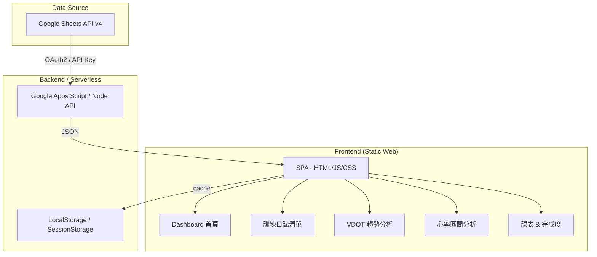
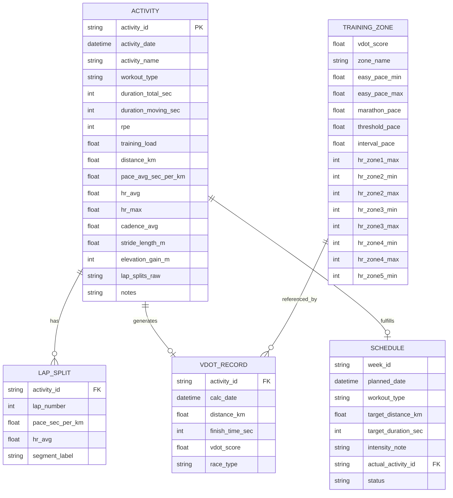
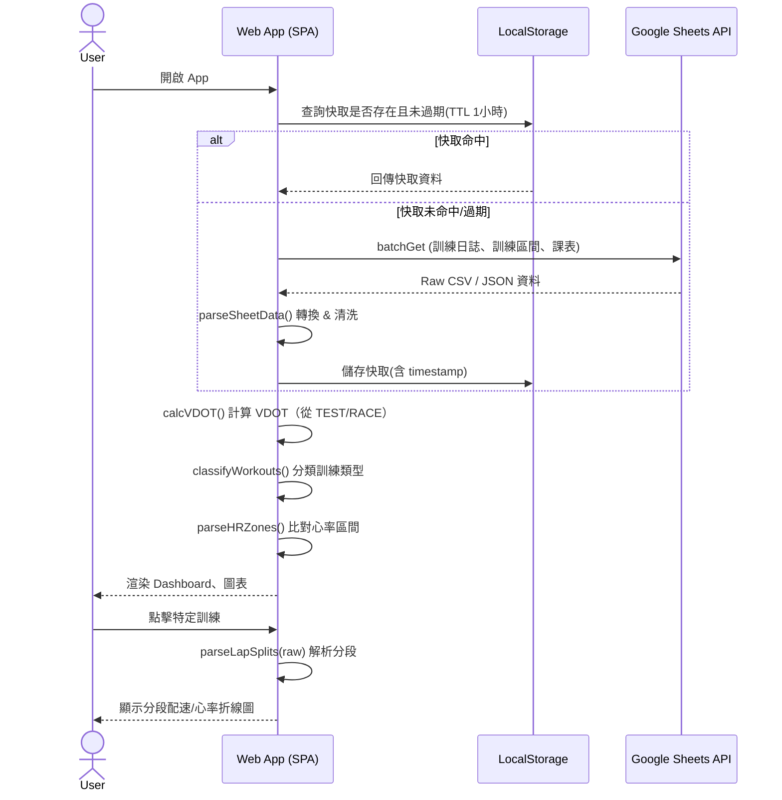

# 個人跑步數據解析與 VDOT 心率分析器 — 專案規格書

> **角色**: PM (Technical Project Manager) + SA (Senior Systems Analyst)  
> **日期**: 2026-10-12  
> **試算表來源**: [訓練日誌](https://docs.google.com/spreadsheets/d/1DahiYbLvl4zR6-5EABCSwTATCtkP7N3IywSxWo5JKas/)

---

## 1. 功能概述 (Overview)

### 1.1 專案背景

使用者已在 Google 試算表維護多年跑步訓練日誌（2020 台北馬 ～ 2026 年），欄位涵蓋 Garmin 活動匯出的詳細資料（活動ID、時間、配速、心率、步頻、每公里分段等）。  
目標是建立一個 Web 小專案，自動讀取試算表資料，提供：
- 歷史訓練趨勢分析
- VDOT 計算與追蹤
- 心率區間分析（對照訓練區間表）
- 課表完成度追蹤

### 1.2 現有試算表 Schema

#### 頁籤 1 — 訓練日誌（實際觀測欄位）

| 欄位名稱 | 資料型態 | 範例值 | 說明 |
|---|---|---|---|
| 活動ID | STRING | `20520732623` | Garmin 活動唯一 ID |
| 日期 | DATETIME | `2026-10-10T05:39:15Z` | ISO 8601 UTC 格式 |
| 名稱 | STRING | `E-90min`, `3min T x 6` | 訓練類型/名稱 |
| 總時間 | STRING (HH:MM:SS) | `1:30:04` | 含暖身緩跑 |
| 移動時間 | STRING (HH:MM:SS) | `1:30:04` | 扣除停頓時間 |
| RPE指標 | INT | `3` (1–10) | 主觀疲勞指數 |
| 訓練點數 | FLOAT | `19` | 自訂訓練負荷分 |
| 距離(km) | FLOAT | `12.72` | 總距離 |
| 配速(min/km) | STRING | `7:05` | 平均配速 MM:SS |
| 平均心率(bpm) | FLOAT | `124.2` | 全程平均心率 |
| 最大心率(bpm) | FLOAT | `137` | 全程最大心率 |
| 平均步頻(spm) | FLOAT | `186` | 每分鐘步數 |
| 平均步幅(m) | FLOAT | `0.76` | 平均步幅（公尺） |
| 總爬升(m) | FLOAT | `3` | 累積爬升 |
| 每公里分段 | TEXT | `1k(7:32, 110bpm) \| 2k(...)` | 管道符號分隔的分段資料 |
| 備註 | TEXT | `今天下雨, 微風...` | 選填主觀感受 |

**訓練類型命名規則（從資料歸納）**：
- `E-XXmin` → Easy 輕鬆跑（E 跑）
- `T - X x Ykm` / `Xmin T x N` → Threshold 乳酸閾值跑
- `200m R × N` → Repetition 重複跑
- `5K-Test` → 測驗跑（用於 VDOT 計算）
- `2025 萬金石` 等 → 比賽

#### 頁籤 2 — 訓練區間（gid=1124408140）✅ 已確認

基準：**2026/03/14 五公里測驗，VDOT 36**（下次測驗 2026/10/24）

| Zone | 訓練強度 | 建議配速 (min/km) | 心率目標 (bpm) | %LTHR | 核心目的 |
|---|---|---|---|---|---|
| Zone 1 | 恢復跑 | > 7:10 | 112 – 137 | 65%–80% | 主動修復、乳酸清除 |
| Zone 2 | 輕鬆跑 (E) | 6:25 – 7:09 | 138 – 153 | 80%–89% | 有氧基底、累積底子 |
| Zone 3 | 馬拉松 (M) | 6:01 | 154 – 163 | 89%–95% | 模擬馬拉松賽速 |
| Zone 4 | 門檻跑 (T) | 5:29 | 164 – 172 | 95%–100% | 提升乳酸代謝效率 |
| Zone 5a | 最大攝氧 (I) | 5:04 | 173 – 196 | >100% | 刺激心肺極限 |
| Zone 5b | 重複/速度 (R) | 4:48 | 183 – 196 | >100% | 跑步經濟性、快縮肌 |

**關鍵數值**：最大心率 196 bpm、臨界心率 (LTHR) 172 bpm

#### 頁籤 3 — 課表（gid=196879307）✅ 已確認

**結構**：W1–W7 倒數計時週，目標 2026/10/24 VDOT 測驗

| 欄位 | 說明 |
|---|---|
| `Week` | W1–W7（W1 = 測驗週） |
| `Date` | YYYY-MM-DD |
| `Day` | 星期幾 |
| `Name` | 課表名稱（如 `8K Q1: 3min T x 6 門檻跑`） |
| `Tags` | `E`=輕鬆跑, `Q`=質量課, `L`=長距離 |
| `EST (km)` | 預計距離 |
| `ACT (km)` | 實際完成距離（空白=未完成）|
| `備註與執行重點` | 含 Emoji 的強度說明 |

#### 頁籤 4 — 周里程紀錄（gid=638890324）✅ 額外發現！=>不需要記錄此頁籤

| 欄位 | 說明 |
|---|---|
| `Week` | W1–W7 |
| `預計周里程` | 計畫週總距離 (km) |
| `實際周里程` | 實際完成週總距離 (km) |

---

## 2. 系統架構



---

## 3. 專案 Milestone 與 MVP 範疇

### Milestone 0：基礎架構（P0）
- Google Sheets API 串接（公開讀取或 API Key）
- 資料解析層（CSV → JSON）
- 本地資料快取（避免每次重打 API）

### Milestone 1：MVP 核心功能（P0）
- 訓練日誌清單顯示（含搜尋/篩選）
- VDOT 歷史趨勢圖（從測驗跑計算）
- 心率分布圓餅/長條圖（對照心率區間）

### Milestone 2：進階分析（P1）
- 每公里分段資料解析（折線圖）
- 週訓練量統計（距離、時間）
- 訓練類型分布（E/T/R/Race）

### Milestone 3：課表整合（P2）
- 課表顯示與計劃 vs 實際對比
- 訓練建議（依 VDOT 自動推算配速區間）

---

## 4. 資料庫 Schema（Frontend 使用 IndexedDB 或純 JS 物件）



---

## 5. 商業邏輯與規則 (Business Logic & Rules)

### 5.1 訓練類型自動判斷

```
IF name MATCHES /^E-/ OR name MATCHES /輕鬆跑/ OR name MATCHES /Easy/i
  → workout_type = "EASY"
ELSE IF name MATCHES /^T / OR name MATCHES /T x/ OR name MATCHES /Threshold/i
  → workout_type = "THRESHOLD"
ELSE IF name MATCHES /^R / OR name MATCHES /R ×/ OR name MATCHES /Repetition/i
  → workout_type = "REPETITION"
ELSE IF name MATCHES /馬|Marathon|半馬|Half/
  → workout_type = "RACE"
ELSE IF name MATCHES /Test|測驗/
  → workout_type = "TEST"
ELSE
  → workout_type = "GENERAL"
```

### 5.2 VDOT 計算邏輯（從測驗跑/比賽）

使用 Jack Daniels 公式（Daniels Running Formula）：
1. **輸入**：distance_km, finish_time_sec
2. **計算 VO2**：`VO2 = -4.60 + 0.182258 * (d/t) + 0.000104 * (d/t)^2`  
   （d = 公尺, t = 分鐘）
3. **計算 VO2max 百分比**：`%VO2max = 0.8 + 0.1894393*e^(-0.012778*t) + 0.2989558*e^(-0.1932605*t)`
4. **VDOT = VO2 / %VO2max**

> [!IMPORTANT]
> VDOT 僅對 TEST 和 RACE 類型活動計算。預設使用最近一次測驗/比賽的 VDOT。

### 5.3 每公里分段解析

原始格式：`1k(7:32, 110bpm) | 2k(7:17, 118bpm) | ...`  
正則解析：`/(\d+)k\((\d+:\d+),\s*(?:Max\d+bpm,\s*Avg)?(\d+(?:\.\d+)?)bpm\)/g`

輸出：`{ lap: 1, pace: "7:32", pace_sec: 452, hr: 110 }`

### 5.4 心率區間分類

依 TRAINING_ZONE 表對比每筆活動的平均心率：

| 區間名稱 | 說明 |
|---|---|
| Zone 1 (Recovery) | 恢復跑，HR < Zone2_min |
| Zone 2 (Easy/Aerobic) | 有氧基礎 |
| Zone 3 (Tempo) | 乳酸閾值附近 |
| Zone 4 (Threshold) | 高強度有氧 |
| Zone 5 (VO2max) | 最大攝氧量 |

---

## 6. 欄位對應表 (Data Mapping)

### Google Sheets → JavaScript 物件

| 試算表欄位 | JS 屬性名稱 | 型態 | 轉換邏輯 |
|---|---|---|---|
| 活動ID | `activityId` | string | 直接對應 |
| 日期 | `activityDate` | Date | `new Date(value)` |
| 名稱 | `activityName` | string | trim() |
| 總時間 | `durationTotal` | number(sec) | HH:MM:SS → 秒 |
| 移動時間 | `durationMoving` | number(sec) | HH:MM:SS → 秒 |
| RPE指標 | `rpe` | number | parseInt() |
| 訓練點數 | `trainingLoad` | number | parseFloat() |
| 距離(km) | `distanceKm` | number | parseFloat() |
| 配速(min/km) | `paceAvg` | number(sec/km) | MM:SS → 秒 |
| 平均心率(bpm) | `hrAvg` | number | parseFloat() |
| 最大心率(bpm) | `hrMax` | number | parseFloat() |
| 平均步頻(spm) | `cadenceAvg` | number | parseFloat() |
| 平均步幅(m) | `strideLengthM` | number | parseFloat() |
| 總爬升(m) | `elevationGain` | number | parseFloat() |
| 每公里分段 | `lapSplitsRaw` | string | 原始保存，另解析為 `lapSplits[]` |
| 備註 | `notes` | string | trim() |

---

## 7. API 規格 (Google Sheets 串接)

### 方案一：Google Sheets API v4（推薦）

```
GET https://sheets.googleapis.com/v4/spreadsheets/{SPREADSHEET_ID}/values/{RANGE}
Authorization: Bearer {TOKEN}  // OAuth2 or API Key (public sheet)
```

```javascript
// 範例
const SHEET_ID = '1DahiYbLvl4zR6-5EABCSwTATCtkP7N3IywSxWo5JKas';
const API_KEY = 'YOUR_API_KEY';
const ranges = [
  '訓練日誌!A:P',  // Tab1
  '訓練區間!A:K',  // Tab2
  '課表!A:G',      // Tab3
];
const url = `https://sheets.googleapis.com/v4/spreadsheets/${SHEET_ID}/values:batchGet?ranges=${ranges.join('&ranges=')}&key=${API_KEY}`;
```

### 方案二：CSV Export（無需 API Key，適合公開試算表）

```
GET https://docs.google.com/spreadsheets/d/{ID}/export?format=csv&gid=0
```

> [!WARNING]
> CSV 方案不需認證，但頁籤 2、3 需要正確的 gid 值（需從試算表 URL 取得）。

---

## 8. 系統流程圖



---

## 9. 任務拆解清單 (Task Breakdown List)

### 任務概覽

| Task ID | 任務名稱 | 負責角色 | 優先級 | 依賴任務 | 預估工時 |
|---|---|---|---|---|---|
| T-01 | 專案初始化 & 環境建置 | FE | P0 | — | 0.5h |
| T-02 | Google Sheets API 串接模組 | FE/BE | P0 | T-01 | 2h |
| T-03 | 訓練日誌資料解析層 | FE | P0 | T-02 | 3h |
| T-04 | 設計系統 & 全域 CSS | FE | P0 | T-01 | 2h |
| T-05 | Dashboard 首頁佈局 | FE | P0 | T-04 | 1h |
| T-06 | 訓練日誌清單頁 | FE | P0 | T-03, T-04 | 3h |
| T-07 | VDOT 計算邏輯 | FE | P0 | T-03 | 2h |
| T-08 | VDOT 趨勢圖（Chart.js） | FE | P0 | T-07, T-05 | 2h |
| T-09 | 心率區間分析圖 | FE | P1 | T-03, T-08 | 2h |
| T-10 | 訓練類型分類 & 週量統計圖 | FE | P1 | T-03 | 2h |
| T-11 | 每公里分段解析 & 折線圖 | FE | P1 | T-06 | 3h |
| T-12 | 課表頁（計畫 vs 實際） | FE | P2 | T-06 | 3h |
| T-13 | LocalStorage 快取機制 | FE | P1 | T-02 | 1h |
| T-14 | RWD 響應式設計 & 手機優化 | FE | P2 | T-05 | 2h |
| T-15 | 部署（GitHub Pages / Netlify） | DevOps | P2 | 全部 | 1h |

---

## 10. 當前執行 Task 詳細說明

### T-02：Google Sheets API 串接模組

**目標**：建立可複用的資料載入函式，支援 CSV Export 方案（無需認證）。

**Acceptance Criteria (DoD)**：
- [ ] `fetchSheetData(sheetId, gid)` 函式可正確取得 CSV 並解析為二維陣列
- [ ] `batchFetchAllTabs()` 並行取得 3 個頁籤
- [ ] 錯誤處理：網路失敗時 fallback 至快取
- [ ] console.log 顯示原始 rows 數量

**實作提示**：
```javascript
async function fetchSheetCSV(sheetId, gid = 0) {
  const url = `https://docs.google.com/spreadsheets/d/${sheetId}/export?format=csv&gid=${gid}`;
  const res = await fetch(url);
  if (!res.ok) throw new Error(`Fetch failed: ${res.status}`);
  const text = await res.text();
  return parseCSV(text); // 自訂 CSV parser（處理引號內的逗號）
}
```

---

### T-03：訓練日誌資料解析層

**目標**：將 CSV 二維陣列轉換為結構化 Activity 物件陣列。

**Acceptance Criteria (DoD)**：
- [ ] `mapRowToActivity(row)` 正確轉換所有 16 欄
- [ ] 時間格式（`1:30:04`）正確轉為秒數
- [ ] 配速格式（`7:05`）正確轉為秒/公里
- [ ] `workout_type` 自動分類（依 5.1 規則）
- [ ] 無效資料列（如 test01）正確過濾

---

### T-07：VDOT 計算邏輯

**目標**：從 RACE/TEST 類型活動計算 VDOT，追蹤趨勢。

**Acceptance Criteria (DoD)**：
- [ ] `calcVDOT(distanceKm, finishTimeSec)` 返回 VDOT float
- [ ] 從所有 RACE/TEST 活動自動篩選並計算
- [ ] VDOT 結果與公開 VDOT calculator 誤差 < 0.5
- [ ] 已知比賽驗證：2022 台北馬（3:56:08, 43km）≈ VDOT 40–41

---

## 11. 技術選型建議

| 類別 | 工具 | 理由 |
|---|---|---|
| 框架 | 純 HTML + Vanilla JS | 輕量、無需 build，適合 Web 小專案 |
| 圖表 | Chart.js v4 | 易用、功能完整，社群活躍 |
| CSS | Vanilla CSS + CSS Variables | 完全控制設計系統 |
| 字型 | Google Fonts (Inter / Outfit) | 現代感、可讀性佳 |
| 部署 | GitHub Pages | 免費、CI/CD 簡單 |
| 資料存取 | Google Sheets CSV Export | 無需 OAuth，適合個人專案 |

---

## 12. 已確認資訊（TBD 全數解決）✅

| 項目 | 狀態 | 確認值 |
|---|---|---|
| ~~TBD-01~~ 訓練區間 gid | ✅ 已確認 | `gid=1124408140` |
| ~~TBD-02~~ 課表 gid | ✅ 已確認 | `gid=196879307` |
| ~~TBD-03~~ 心率上下限 | ✅ 已確認 | 最大心率 196 bpm，LTHR 172 bpm |
| ~~TBD-04~~ 試算表公開設定 | ✅ 已確認 | 無需登入，CSV Export 可直接存取 |
| ~~TBD-05~~ 認證需求 | ✅ 不需要 | 純 CSV Export，無需 OAuth2 |
| TBD-06 | ✅ 不需要此需求 | 是否要寫入功能（手動新增訓練）? |

## 13. 四個頁籤的 gid 對照表

| 頁籤名稱 | gid | CSV Export URL |	備註	|
|---|---|---|
| 訓練日誌 | `0` | `...export?format=csv&gid=0` ||
| 訓練區間 | `1124408140` | `...export?format=csv&gid=1124408140` ||
| 課表 | `196879307` | `...export?format=csv&gid=196879307` ||
| 周里程紀錄 | `638890324` | `...export?format=csv&gid=638890324` |	這個頁籤不需要	|
